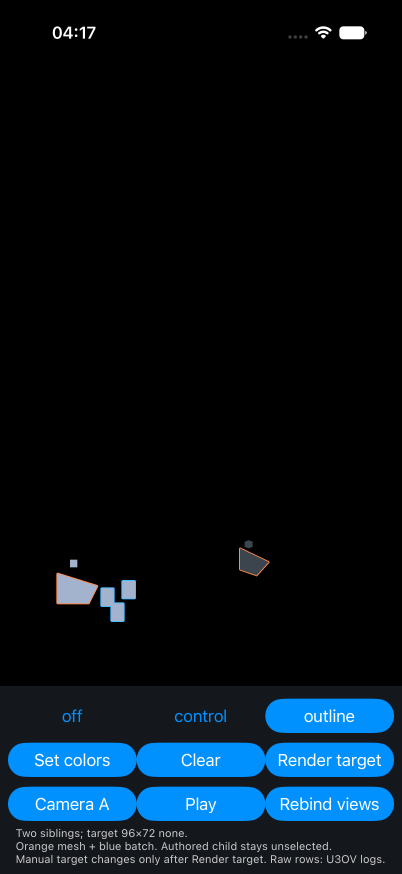

# Private update callback fixes mask freshness; first target contour still fails

The matched simulator control makes all four first Set/Clear masks current.
The complete manual-target requirement still fails. Its first outlined output
contains no contour despite a correct mask. No production source change is accepted.

The parent ran the approved iPhone 17 Pro simulator on 2026-10-28. Both launches
used the exact same runtime70 packet, changing only
`DART3D_U3_OUTLINE_PUBLISH_IN_UPDATE=false|true`. The packet SHA256 is
`f24f666fca2af5f574fb7b745fa63a04158d3fce1bbfdbfbec7854b9488ee672`.
It differs from the worker packet by one comment deletion.

The existing public path is `setNodeHighlights` followed by an explicit
`renderTexture` request. The control publishes the target's detached mask graph
inside its private renderer's own update callback during the existing single
update-and-render call. Selection ownership, source simulation, ordinary target
rendering, shaders, scheduler, and the private alpha test are unchanged.

## Matched first-request results

| Transition | Baseline mask support | Controlled mask support | Expected support | Controlled target contour mismatches |
| --- | ---: | ---: | ---: | ---: |
| First Set | 0 | 205 | 205 | 267 |
| First Clear | 205 | 0 | 0 | 0 |
| Second Set | 0 | 205 | 205 | 0 |
| Second Clear | 205 | 0 | 0 | 0 |

Each controlled callback logs the current three draws after Set and zero after
Clear, with the same time as the mask and ordinary target encode. Its log precedes
both encodes. This supports the private-update publication route for this fixture.
It does not establish SceneKit's internal cause or general production readiness.

The first controlled mask contains 205 selected pixels and produces 267 contour
pixels under the pinned radius-three kernel. The actual target is byte-identical
to its initial Off output, so all 267 contour pixels are missing. The next three
target outputs match their actual masks exactly. Every controlled target preserves
all outside-contour RGBA bytes. The baseline's four target outputs also match
their actual, stale masks. Arithmetic correctness does not establish mask freshness.

See [baseline analysis](baseline/analysis.json), [control analysis](control/analysis.json),
and each run's `first-use.json`. The complete raw files and texture metadata are
under each run's `raw/` directory. `analyze.dart` retains the pixel oracle.

The separate synthetic alpha test still fails on its first invocation in both
runs. Each first output is entirely `(0,0,0,255)` across 6,912 pixels. The remaining
three outputs in each run preserve outside RGBA and match their respective masks.
No shared cause with the missing first target contour has been established.
Do not interpret the control's smaller outside-contour failure count as an
improvement in alpha output; its first mask simply has a nonempty contour.

## Preserved behavior and evidence

Both runs have five admitted target draws, the initial draw plus four explicit
requests. All four held, dirty=false stored reads per run remain byte-identical
to their preceding target output. There is no extra update, draw, retry, wait,
target dirtying, or new queue. Eleven matched frozen screen crops have zero RGB
differences in [pixel-comparisons.json](pixel-comparisons.json). These are static
screen observations, not moving alignment or screen alpha proof.

The left sibling shows orange mesh and blue batch contours. The other camera
shows the orange mesh. The separated authored child remains unoutlined. The
manual texture is judged through native readback, not this screen capture.

The parent reran 23 fixture/W34 tests. Both native app builds and runs completed.
Per-PID logs report zero matches for the retained error-marker query. The worker's
13 highlight tests, analysis, Swift typecheck, and generic build are worker
receipts in [verification.md](worker/verification.md). Their source proof does
not replace the failing native target result.

`runtime-source/` identifies the actual source used for both launches. `worker/`
retains the diagnosis, control patch, and checks. Full native log and two original
videos remain local at the hashed paths in [local-originals.json](local-originals.json).
Video decoding receipts and stderr are retained separately. Encoded video timing
does not establish interaction latency or performance.
Both videos fully decode, totaling 7,713 frames. FFmpeg reports four duplicate
DTS warnings for baseline and two for control. The original warnings are retained.

## Cleanup and remaining gate

Accepted final66 and all 4,702 pre-existing files are restored. The four own probe
additions are removed. Normal-main configuration and generated Pod source list
are restored. Six locks/registrants are unchanged. The app, recorder, and logger
are stopped, and the owned simulator is shut down. See
[restoration](restore-receipt.json) and [final configuration](final-config-receipt.json).
The A142 remains reserved and was not used.

Next investigate first-target technique installation/preparation at the existing
target renderer owner. Keep the private alpha failure separate. No automatic
warm-up render, second render, source-scene update, or scheduler change is accepted.
Moving deformation, single host, MSAA, view replacement, retirement, W34 coexistence,
scaled width, Android, performance, T2/T4, and whole-U3 acceptance remain NOT_RUN.
