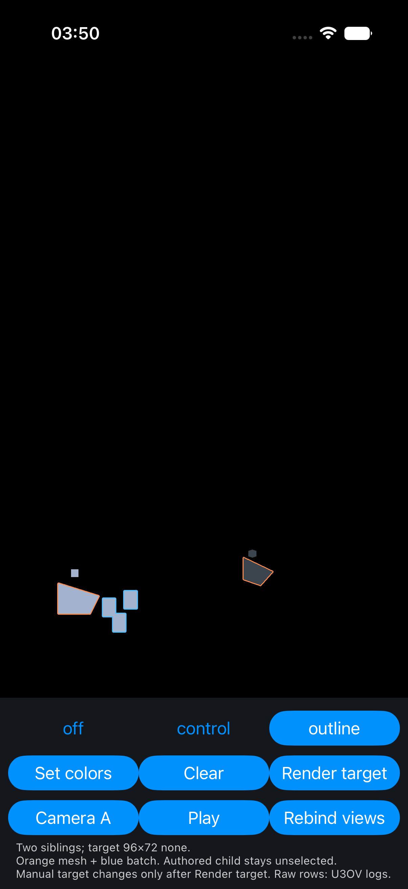

# iOS per-view outline capability: manual-target gate failed

The recorded finite probe fails the current-selection requirement for a manual
render texture. Both screen siblings show the expected static orange/blue
contours, but the first requested target render after Set or Clear uses the
previous private-scene membership. This is not production integration or U3
acceptance. No cause or correction is confirmed.

The parent ran the approved iPhone 17 Pro simulator on 2026-10-28. The A142 was
not used. The app, recorder, logger and simulator are stopped. Accepted final66
source and all 4,463 pre-existing files are restored; the four temporary source
additions are removed. Normal-main configuration and generated Pod source list
are restored, and all six locks/registrants are unchanged. See
[restore-receipt.json](restore-receipt.json) and
[final-config-receipt.json](final-config-receipt.json).

## Recorded boundary

The real path is `SceneController.setNodeHighlights` → native SelectionOutline
map → captured frame → existing manual-target admission → private per-view mask
→ ordinary target draw and its composite-only technique. The CPU frame logs the
current three owned draws after Set and none after Clear. The mask's GPU bytes
instead show the prior membership on the first requested render. That violates
the requirement that an explicit public render draw current selection.

The existing mask binding owns its private scene, nodes, camera and renderer.
Selection state remains in its reviewed native owner. The consumer target and
ordinary scene owners were not replaced. The finding is at the private-scene
publication/capture boundary; transactions, renderer update/prepare timing and
reuse are hypotheses to investigate, not established causes.

| Target callback time | Captured CPU state | GPU mask support | Contour pixels | Meaning |
| --- | --- | ---: | ---: | --- |
| 539791.4000000001 | Set, 3 draws | 0 | 0 | First render after Set failed |
| 539796.3166666668 | Clear, 0 draws | 205 | 267 | First render after Clear failed |
| 539887.0000000001 | Clear, 0 draws | 0 | 0 | Extra render, diagnostic only |
| 539891.2000000001 | Set, 3 draws | 0 | 0 | Repeated first-render failure |
| 539893.1000000001 | Set, 3 draws | 205 | 267 | Extra render, diagnostic only |
| 539897.0000000001 | Clear, 0 draws | 205 | 267 | Repeated first-render failure |

The extra renders discriminate delayed state. They are not retries accepted as
a fix or evidence that the required manual operation passes. Every target pass
is no-AA, 96×72. Single-screen host, MSAA, motion/alignment, Control mode with
the native probe, view replacement, retirement stress, W34 coexistence and
reduced-scale width were not run after this decisive failure.

[Raw analysis](failure-analysis.json) joins each mask/readback to the exact
native CPU event. [Schedule events](split/schedule.log) record seven due draws
(initial plus six explicit render requests), four public set/clear batches,
and the mask-before-normal encode calls. All four stored-target readbacks are
byte-identical to their preceding target output while dirty=false. There are
no intervening due encodes in those held phases. Scheduling/stored output is
preserved; current membership on the requested draw fails.

## Positive observations, with limits

The simultaneous static siblings have different camera silhouettes and layer
membership. The left shows the selected mesh and batch; the right excludes the
batch. The separated authored child stays unoutlined. This is inspected screen
output, not raw screen-attachment alpha or moving-pose proof. Four frozen RGB
crop comparisons are exact in [pixel-comparisons.json](pixel-comparisons.json),
including baseline versus probe-Off and Off restoration.

The target composite executes over the actual target. Relative to each actual
GPU mask, all six target outputs preserve every outside-contour RGBA pixel and
match the pinned kernel's selected neighbor RGB/opaque alpha on the contour.
This does not repair a stale mask. The populated masks contain exactly
`(1,.25,.0625,1)` and `(.0625,.5,1,.5)` in RGBA16Float, including zero-alpha input
substitution to one. The 205 selected pixels lie inside the ordinary base's
geometry support; 12 base-only pixels remain unselected. These static
observations are in [mask-alignment.json](mask-alignment.json).

The private known-input alpha output fails on its first invocation: all 6,912
outside-contour pixels differ from its supplied input. The five later outputs
preserve outside-contour bytes and have correct opaque contour values relative
to their actual mask. Keep the initial failure open; it is not certified as the
same cause as the membership delay. No separate compositor or CPU image was
substituted for actual native output.

The target is BGRA8 sRGB (Metal81); masks are RGBA16Float (Metal115). Raw bytes,
format/dimension/label metadata and byte-order-only PNG views are under `raw/`.
The oracle uses the pinned radius-three circular kernel, strict-greater
coverage ties and sRGB transfer at texel centers. Source selection correctness
is assessed separately from arithmetic against an already captured mask.

## Runtime alpha corrects the earlier source-only inference

The pass descriptor in source clears alpha to one, but the initial actual
rendered target has 6,695 zero-alpha pixels and 217 opaque geometry pixels.
The earlier plan's inference that this target could not expose transparency was
too strong for this fixture. These are direct native readback observations;
they do not create or define a new public transparent-target feature. The
private known-input test remains a separate arithmetic/encoding oracle.

## Source and execution receipts

`before/` contains the original final66 native renderer plus only the three Dart
fixture files. `runtime-source/source.tgz` is the exact imported runtime70 after
14 comment-line deletions, SHA256
`73ae660ec88b9aaafe743d32c44742017044d61a6a9773f909fab7699ff22c0b`.
All code changes are reversible and remain outside accepted production source.
`worker-source/` is the original prepared packet and host checks. The loose
`split/source-sha256.json` is the initial worker-import checkpoint; use
`runtime-source/source-sha256.json` or `split/packet/` for actual runtime identity.

The first parent native build reported `Cannot find type 'OutlineViewsBinding'
in scope`: the generated Pods project omitted the newly added Swift file.
`pod install` regenerated its source list without lock changes, then the native
build/run succeeded. The failure and refreshed run are both retained. Parent
fixture/W34 tests pass21 and example analysis is clean. The worker's additional
13 highlight tests, typecheck and generic app build are inspected worker
receipts, not independent parent runs. Metal and the no-AA native target path
actually executed during this parent probe; the remaining lanes are NOT_RUN.

The comment audit accepted seven blocks/14 lines of deletion. Its initial
ownership MUST KILL was withdrawn on rerun after tracing the existing producer
invariant; no executable code changed. The external CPU-callback-versus-GPU-
completion constraint and style-only implementation_imports suppression remain.

Probe PID26941 has zero matches for the recorded fatal/shader/cross-scene/
transaction/selector/UI/GPU-error/BLOCKED regex. Functional failure still exists.
All exact retrieval paths were supplied by native RAW log records. The parent
copied those owned output files directly from the reported host paths; no
simulator-container query or physical-device operation was used.

Both original recordings fully decode: 5,715 + 36,656 = 42,371 frames. Commands,
hashes, dimensions, time ranges, exits and retained duplicate/nonmonotonic DTS
warnings are in [video-receipts.json](video-receipts.json). This is not FPS,
latency, smoothness or ordering proof. The videos and full native log remain at
hashed local paths in [local-originals.json](local-originals.json); they are not
published. Raw data and small images/logs are copied here.

Next: source-grounded diagnosis and one minimal reversible publication control,
if a real native API supports it. No automatic extra draw, target dirtying,
synchronous GPU wait, new queue/clock, explicit post-scene Metal presentation
compositor or architecture expansion is authorized by this failure. Android,
production integration, performance, whole U3 and T2/T4 remain open. Independent
review of this negative result and any later correction remains pending.
