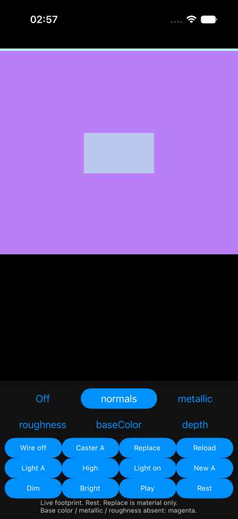
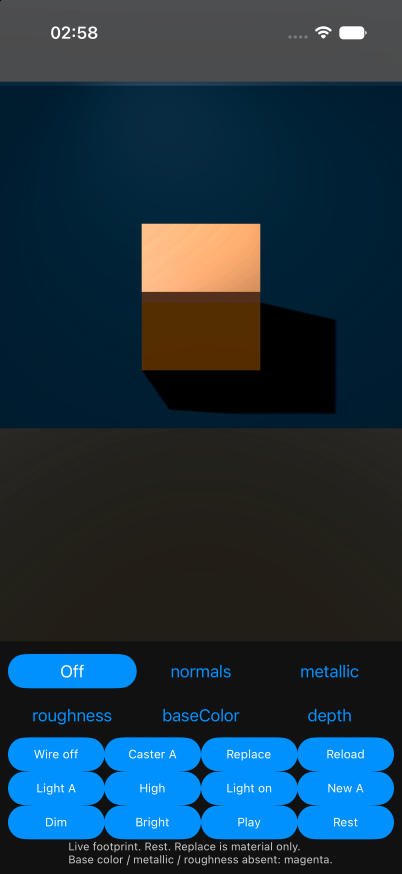
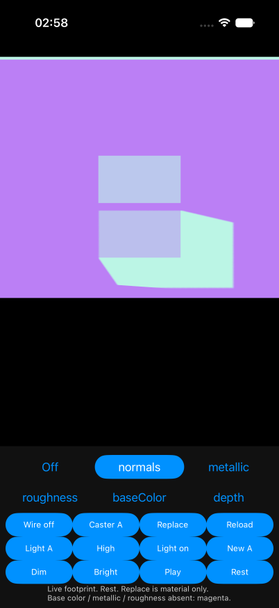

# iOS live-catcher debug views

The simulator replay shows live shadow coverage in all five debug channels,
current light updates, source-view restoration, and the translucent-caster
correction. [Independent Codex review](codex-review/review.md) passed with no
reachable material P1/P2 finding. This does not complete W34,
E9, or Track E.

## Behavior and ownership

The existing `d3.shadowCatcher:<key>` material keeps SceneKit `shadowOnly`
coverage. A diagnostic copy replaces RGB and premultiplies it by the existing
native output alpha once; it does not write alpha or infer a mask from shadow
color. Normals and axial depth describe the receiver. Base color, metallic and
roughness are absent inputs and show magenta under its actual coverage.

The capture owner retains immutable source-light templates. The main thread
owns a separate displayed copy. Current native color and ten scalar/settings
fields cross the existing frame mailbox; changes do not copy a whole light on
every sample. Source attachments remain authored-scene owned. The exact six-file
change and all 66 context identities are in [the source packet](source/receipt.json).
The existing source transparent pragma and selected-channel view reuse remain.

## Before and after

The initial `before/` captures use the accepted native baseline with the new
fixture only. They show the unsupported live material's full white receiver in
debug mode. `traced/` and probe-free `clean/` use the new live materials and light
state. `final-clean/` repeats a finite subset at the final corrected source.
`pbr-regression/` and `final-pbr/` preserve the ordinary PBR channels.

Source review then found that the private scene excluded the host's invisible,
depth-only stand-ins for blended casters. The production public path is a
physically based mesh with `alphaMode: blend`; the host creates the stand-in
because the blended material does not write shadow depth.

| Translucent caster | Authored Off | Normals |
| --- | --- | --- |
| Before |  |  |
| Corrected |  |  |

The final capture includes that source-owned stand-in with its copied original
material, empty color-write mask and depth writes. It retains pose, draw order,
visibility and casts-shadow state. Visible meshes still get channel materials.
The corrected journey covers movement, depth, base color, wireframe, material
upsert, reload and Off. This uses an authored translucent material, not a
synthetic shadow mask. Skinned/morphed/facing blend-shadow limitations of the
existing source stand-in path are unchanged.

## Reproduction and source identities

Run from `dart3d/example` on the approved iPhone 17 Pro simulator:

```sh
dn run --no-pub -d C24F3C6D-A3A9-4FB7-978E-36E67EF55354 \
  -t lib/w34_debug_main.dart \
  --dart-define=DART3D_W34_LIVE_CATCHER=true
```

Add `--dart-define=DART3D_W34_LIVE_BLEND_CASTER=true` for the translucent caster.
Use Off/normals/depth/baseColor, Caster, Wire, Replace and Reload. The ordinary
live fixture also has Light A/B, High/Low, Light on/off, New A/B, Dim, Bright,
Play/Pause and Rest. Replace upserts only the unchanged same-ID material.
Reload keeps authored scene edits and resets playback to Rest.

Each stage's `packet/source-sha256.json` records its full context. The final
production packet differs from final-clean runtime only in the guide. Earlier
packets remain historical snapshots. The six owned paths are the two native
files, three W34 fixture/test files and `docs/debug-views.md`; 60 overlay peers,
3,467 other pre-existing paths and all six locks/registrants are preserved.
Forward/reverse replay of every source is recorded in `source/receipt.json`.
Temporary native trace and adapter probes were removed before clean runs.

## Native values and finite lifetime checks

[Native summary](native-summary.json) and [raw parsed records](native-analysis.json)
retain 162 traced samples with matching input/displayed values for all eleven
named fields, native colors and attachment status. One 85-sample epoch retains
its template/display identities while intensity changes and quality switches
shadow casting. Ten template-creation and ten display-creation call-site events
span activation/replacement epochs; they are not global allocation counts.
Four removal events leave zero display slots, and sampled capture-template
counts alternate between one and zero. Reused addresses are not revision IDs.
Uninstrumented creation/sample counts are null, not inferred zero.

The unattached native adapter probe uses an immutable extended-linear-sRGB
CGColor with a 1.6 component. It verifies exact color assignment, all eleven
state assignments, and an unchanged frozen template. It does not calibrate
rendered color, physical shadow accuracy, or fragment alpha.

The final four process receipts are in [final-native-analysis.json](final-native-analysis.json).
Their queried fatal/shader/cross-scene/transaction/selector/UI error patterns
have zero matches. Apps quit normally. Shutting down the simulator ended the
last log-stream process with exit 137; that is not an app exit result.
The inherited property-animation capability warning remains in run logs.

## Image and recording checks

[Initial comparisons](pixel-analysis.json) contain 80 comparisons, with all 69
expected-stable comparisons exact in the stated scene crops.
[Final comparisons](final-pixel-analysis.json) contain 38 comparisons, with all
34 expected-stable comparisons exact. These include unchanged authored Off,
opaque live regression and five PBR channels. Four changed debug comparisons
establish the translucent-caster correction. A first comparison script paired
PBR files by numeric prefix despite a different capture order; its retained
mismatch log is a script error. Final matching uses the actual channel name.
Encoded screenshot RGBA is composited display output, not native fragment alpha.

All eleven original videos fully probe and decode: 47,400 frames total.
[Earlier receipts](video-receipts.json) cover eight originals and
[final receipts](final-video-receipts.json) cover three. Full commands, hashes,
exit codes, time ranges, dimensions and stderr are retained. FFmpeg's null
output reports duplicate/nonmonotonic DTS warnings; this is not a warning-free
or frame-time/latency result. Stills and contact sheets are copied here.
Original recordings and complete system logs remain at the exact local paths
and hashes in [local-originals.json](local-originals.json); they are not published.

The final translucent journey is
`/private/tmp/dart3d-w34-ios-live-production-20261028/r1/parent/blend-after/journey.mp4`.
The final opaque journey is
`/private/tmp/dart3d-w34-ios-live-production-20261028/r1/parent/final-clean/journey.mp4`.

## Host checks and remaining gates

The final source passes 393 package and 341 example tests, both analyses and a
13-file arm64 iOS 15 simulator Swift typecheck. Final native `dn run` builds and
execution cover the new Swift/material path. The earlier scratch typecheck
receipt was replaced by the latest checker invocation; the corrected latest
receipt is under `blend-after/`. Early fixture compile errors and the corrected
passing logs remain, and make no native-failure claim.

No attached light is an existing source limit: authored Off itself draws the
whole receiver. `no-light-control/` confirms the same coverage before and after
material Replace and Reload, with the ordinary footprint restored when its
light returns. Debug mode preserves that behavior; this unit does not fix it.

Raw fragment-alpha/color calibration, shared-light attachments, actual stage-sun
updates, arbitrary native light-property animation, whole-node removal,
queued-generation stress, heap retention, performance, broader consumers,
physical iOS, Android, T2 and operator T4 are NOT_RUN for this unit. Entry/reentry
flashes remain open. Native particles retain the operator-approved unsupported
status. The A142 was not used. Apps, recorders and the owned simulator are stopped;
normal-main build configuration is restored.

The reviewer independently verified the source replay and preservation hashes,
all 118 image comparisons, raw-log counts, and full decoding of the eleven
original videos. It inspected parent tests, builds and native-run evidence;
independent tests, builds and device execution were NOT_RUN. The report and
recomputation receipts are retained under `codex-review/`.
