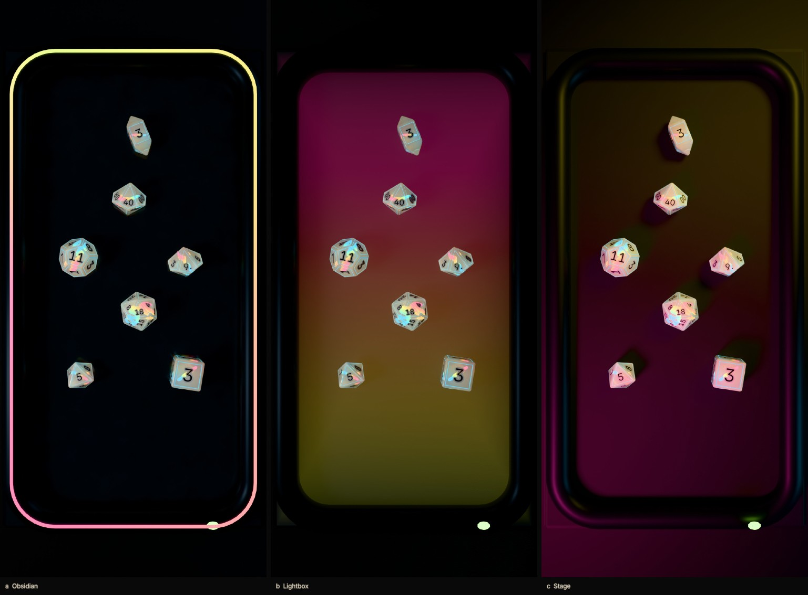
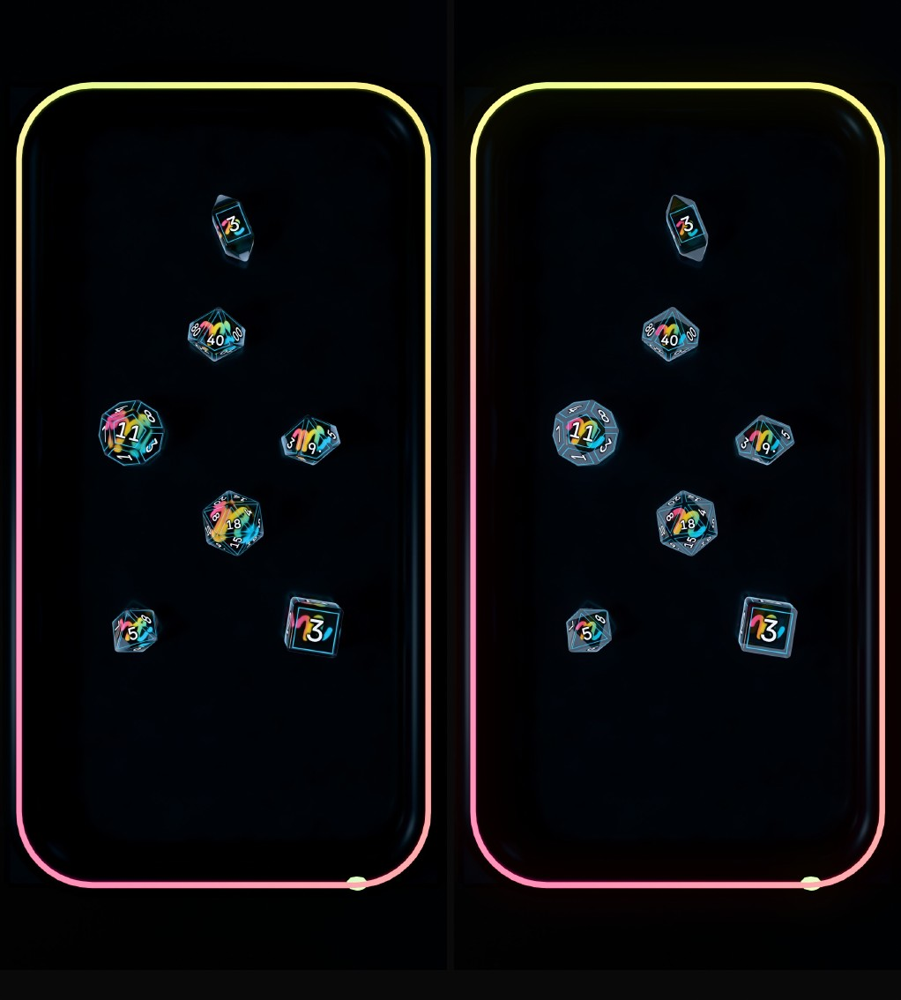
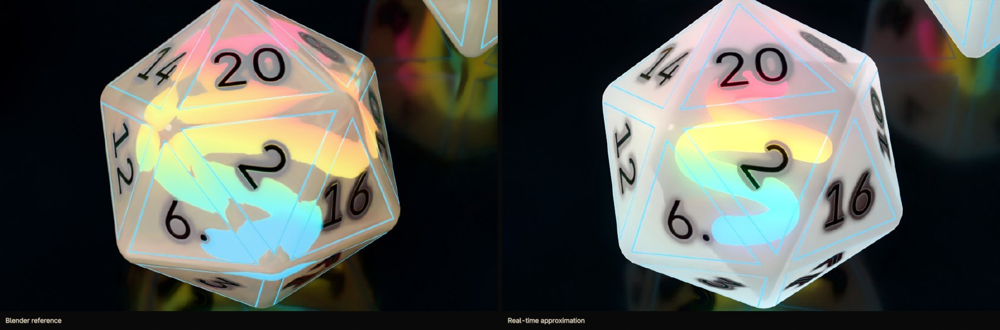

# Dice look-dev: the DartNative set (example-app reference)

> This file is the reference for the **DartNative set only** (§0, §1
> and §3.12, which the example's dice code cites). It was trimmed
> 2026-10-28: the eleven themed sets (§3.1–§3.11), per-set intros
> (§3a), game rooms (§3b) and the production follow-ups (§4–§6) were
> removed from `main` — the full document, the Blender tooling and
> all renders live on branch `p3-game-rooms-wip` (tag
> `archive/p3-game-rooms-wip`), sidelined 2026-10-02. What upstream's
> roller does better and how we beat it (old §2) is covered by
> `docs/design/demo-program.md` §3–§5.

Status: look-dev round 2.1 record, 2026-09-30 (round 2 +
refined numerals and a stricter readability gate, §0.5 in the full
document). Nothing here is app code. The shipped set is built
procedurally in Dart (`dice_set.dart`, `dice_numerals.dart`,
`dice_polyhedra.dart`, `dice_obsidian_tray.dart`); renders:
`docs/design/dice-lookdev/` (DartNative set only). Context:
`docs/design/demo-program.md` §3 (upstream's roller) and §5 (our
Dice Roller plan).

**DartNative** (§3.12: the 3D logo suspended in frosted glass) is
the dart3d example app's own dice set, rolled in its obsidian tray:
an engraved rolling surface as a hero object, a lighting mood and
atmosphere that never compete with the dice.

**Judge from the top-down view first.** The app's camera looks
straight down, so the set's top-down in-app view is its primary
render, and it has to pass a measured readability gate on that view
(§0.2).

| # | Set | Environment | Top-down (primary) | Hero | d4 close-up |
|---|---|---|---|---|---|
| 0 | **DartNative** (example app) | Obsidian tray (recommended of 3) | [topdown](dice-lookdev/dartnative-a-topdown.jpg) · [real-time](dice-lookdev/dartnative-a-rt-topdown.jpg) | [hero](dice-lookdev/dartnative-a-hero.jpg) | [d20](dice-lookdev/dartnative-a-d20.jpg), [d4](dice-lookdev/dartnative-a-d4.jpg) |

Sheets: `readability.json` (on the sidelined branch) holds every
measurement; `dartnative-env-options.jpg` and the
`dartnative-compare-*.jpg` Blender-reference vs real-time pairs are
in `docs/design/dice-lookdev/` (§3.12). All renders are full-colour
JPEG q90.

**IP guardrail.** Every name, symbol and pattern here is original. The
TTRPG lines and the operator's AI mood boards were inspiration only: no
game titles, logos, trademarked symbols or fonts, no copied slogans (props
carry no text at all; the engine's nameplate is blank, the newspaper and
notebook are abstract strokes). Runes and sigils are generated from
strokes by our own code (`_rune`, `sigil_strokes`) and are not a real
script. Fonts: Inter (OFL, bundled with Blender), DejaVu Sans Mono
(Bitstream Vera licence, bundled with Blender) and EB Garamond (OFL,
vendored in `tool/dice_lookdev/fonts/` with its licence).

---

## 0. Readability and the d4 (from look-dev round 2)

### 0.2 The readability system

**Rules (every set):**

1. **Numeral contrast** on the top face, as rendered (display sRGB after
   tone mapping, not albedo): WCAG relative luminance of the numeral's
   **stroke core** against the **plain face** right around it, **≥ 4.5 : 1**
   on every die, taken worst-quartile (the numeral's weakest quarter vs the
   face's closest quarter, so wear, AO, flakes and texture count). The
   keyline is *not* counted for non-glowing sets: their numerals must read
   on the face itself. Glowing sets may count their keyline/glow ring.
   (Round 2 measured medians against the ring including the keyline;
   round 2's Old Road passed that at 6.2 : 1 and was unreadable by eye.
   Re-measured with this rule it fails at 3.8 : 1, plus the stroke gate.)
2. **Numeral size**: the top-face numeral's height is **≥ 40% of the
   face's inscribed width** (worst face of each die, measured from the
   atlas). All dice are also 1.3× the round-1 size, so a d20 numeral is
   ~26 px tall on a 1179 px wide phone render and the d6's ~56 px.
   **Stroke weight**: mean stroke width / numeral height **0.10–0.14**
   (a medium weight with open counters; 2 × area / boundary length, from
   the atlas). Round 2's emboldened glyphs were 0.22–0.28.
3. **A numeral treatment chosen per theme** (table below): glowing
   (emissive numerals, usually inside a dark keyline), inked/filled, bright
   metal or enamel with a dark keyline. The keyline is a second texture in
   the atlas layout (`<theme>_halo.png`: R = numeral dilated by ~0.1 face
   inradius, G = soft glow), so it is exact per glyph. Round 2.1 halved it.
4. **Die vs tray**: the die's silhouette must separate from the tray around
   it by **≥ 2 : 1**, taking the best of three readings: the die's median
   body tone, its mean (which counts glowing numerals and metal edges),
   and its outline (the die's outer 2 px, for rim-lit or neon-edged dice;
   only Voltline needs it). This drove a lighter or darker field under
   most sets (Arcane brass field, Frostbound slate, Gemcutter light grey
   velvet, Fate Engine bright steel, Voltline lightbox, Hearthside
   tea-stained vellum, Old Road dark map, Northfield dark-green mat).
5. **Top-down lighting rules** (the round-1 failures were mostly these):
   - Never put a small, bright light near the camera axis: its reflection
     lands on the top faces as a hotspot over the numeral.
   - Place side keys so their mirror image in a glossy floor lands
     *off* the tray (for a camera at height h and a light at (x, z), the
     reflection sits at x·h/(z+h)).
   - Straight down, a metal numeral or frame mirrors the ceiling. Every
     metal-numeral set gets a big, soft overhead source (`E.overhead`);
     in real time that is the zenith of the IBL.
   - Glass dice print their numerals on the outside only (back-facing
     glyphs are masked), or the far face reads mirrored through the body.

**The check** (`tool/dice_lookdev/readability_check.py`, on the
sidelined branch) runs on every top-down render
(`render_set.py --check`, always on in `render.sh`):

- The beauty frame is kept as a lossless PNG. A second, exact **mask
  pass** re-renders the same camera with each die's material swapped for
  an emission-only mask (R = numeral from the atlas, G = "top face": true
  normal within 14° of up, B = die id), everything else hidden, 1 sample,
  no pixel filter, EXR.
- The mask pass also marks the keyline ring (G = 0.5), so the check knows
  numeral, keyline and plain face per pixel.
- Per die: stroke core = the numeral eroded by ~¼ of its stroke width;
  face ring = plain face in a ring 1…1+r px outside numeral + keyline
  (r = 8% of the numeral's pixel height); "adjacent" ring = right outside
  the numeral, keyline included (counted only for glowing sets).
  Worst-quartile contrast as in rule 1. Die vs a 3–12 px ring of tray
  (other dice excluded, contact shadow included).
- Results merge into `readability.json`; `readability_check.py --table`
  prints the table below. `readability-crops.jpg` shows exactly the
  pixels that were measured.

**Results for the DartNative set** (full renders, 96 samples,
1179×2556; the themed sets' rows are in the full document on the
sidelined branch):

| Set | Numeral treatment | Numeral stroke vs face, worst die (gate 4.5) | Keyline counted? | Die vs tray, worst (gate 2.0) | Top numeral height | Numeral / face width (gate 0.40) | Stroke / height (gate 0.10–0.14) | Result |
|---|---|---|---|---|---|---|---|---|
| DartNative (a) | enamel: near-black numerals on frosted glass, denser-frost band (not counted) | 6.9:1 (d4) | no | 7.3:1 | 28 px | 0.41 | 0.12–0.13 | PASS |
| DartNative (a-rt) | enamel: near-black numerals on frosted glass, denser-frost band (not counted) | 7.8:1 (d10u) | no | 11.2:1 | 28 px | 0.41 | 0.12–0.13 | PASS |
| DartNative (b) | enamel: near-black numerals on frosted glass, denser-frost band (not counted) | 5.9:1 (d4) | no | 2.9:1 | 28 px | 0.41 | 0.12–0.13 | PASS |
| DartNative (c) | enamel: near-black numerals on frosted glass, denser-frost band (not counted) | 8.2:1 (d4) | no | 8.3:1 | 28 px | 0.41 | 0.12–0.13 | PASS |

"Keyline counted?" is yes only for the glowing sets; every other set
reads on the plain face.

### 0.3 The d4 shard

- A square prism along the die's long axis with pyramid caps: section
  1.3 cm, 3.2 cm tip to tip (`SHARD_HALF`, `SHARD_CAP` in `build_dice.py`),
  316 triangles. It rests on one of its four long faces, so the result is
  the face pointing up, read like every other die.
- Numbering: opposite long faces sum to 5 (4 up ↔ 1 down, 2 ↔ 3), asserted
  at build time. One numeral per long face, reading along the crystal,
  ~0.5 of the face width tall (the biggest numeral in the set). The eight
  cap facets are blank (their own atlas cells; 78 of 81 cells used).
- **Face map** (`dice_faces.lookdev.json`): the d4 lists only its four long
  faces with `"shape": "shard"` and no `readout` override: the existing
  "most aligned with up" readout works. The shard cannot come to rest on a
  cap facet: the centre of mass projects outside every cap triangle (a cap
  plane sits 0.78 × section from the centre, a long face 0.5), so it
  topples onto a long face and ignoring the caps is safe.
- Physics: use the convex hull (10 points) as the collider. It rolls along
  its long axis much more readily than end over end, so a throw needs a
  little extra spin about the long axis to look lively (DR2 tuning).

---

## 1. How it is built

The renders came from the procedural Blender pipeline
(`dart3d/example/tool/dice_lookdev/` on the sidelined branch:
`build_dice.py`, `env_common.py`, `env_props.py`,
`build_env_<theme>.py`, `render_set.py`, `readability_check.py`,
`render.sh`; no downloaded assets, Blender 5.2.2, Cycles, Khronos
PBR Neutral view transform). The example app does not use that
pipeline: it ports the geometry and numbering to Dart
(`dice_polyhedra.dart`, `dice_numerals.dart`, `dice_set.dart`).

Scale: 1 Blender unit = 1 cm. Dice are a standard set × `SIZE_SCALE` 1.3
(d20 ≈ 2.9 cm across), the in-app size; the tray's play area stays
15 × 31 cm.

### 1.1 Dice geometry and numbering (shared by every set)

| Die | Shape | Size | Bevel | Tris | Numbering (asserted at build time) |
|---|---|---|---|---|---|
| d4 | **shard**: square prism + pyramid caps, rests on a long face, read from the top face (§0.3) | 1.3 cm section, 3.2 cm long | 0.09, 3 segs | 316 | 1–4, opposite long faces sum to 5 |
| d6 | cube | 2.1 cm | 0.17, 4 segs | 300 | opposite faces sum to 7; 1-2-3 counter-clockwise |
| d8 | octahedron | 2.7 cm tip-to-tip | 0.09, 3 segs | 188 | sum 9 |
| d10 units | pentagonal trapezohedron (planar kites, exact) | 2.9 cm tall | 0.08, 3 segs | 316 | 0–9, sum 9, odd numbers around one pole |
| d10 tens (d%) | same | same | same | 316 | 00–90, sum 90 |
| d12 | dodecahedron | 2.9 cm | 0.09, 3 segs | 476 | sum 13 |
| d20 | icosahedron | 2.9 cm | 0.07, 3 segs | 476 | sum 21 |

- The 6 carries a dot ("6.") on the d10, d12 and d20. The 9 is plain: the
  dot on the 6 is enough to tell them apart (operator, #42). The look-dev
  renders predate that and still show "9.".
- All dice are modelled resting on a face (face up = +Z), so they sit flat
  in the tray.
- Every die is **< 500 triangles**, well under the 2–4k budget. That leaves
  room for more bevel segments on a "high" quality tier. The inner "core"
  hulls of the two glowing sets are 4–36 triangles.
- **Face map.** `dice_faces.lookdev.json` has the same schema as
  `assets/dice/dice_faces.json`: glTF Y-up normals, `"resultSide": "up"`.
  The d4 lists its four long faces (`"shape": "shard"`), like the existing
  Retro Classic and overlay crystal d4s; the "most aligned with up"
  readout works unchanged for every die.

### 1.2 One RGBA atlas per set

> This is the Blender pipeline's layout. The example app does not use it:
> it builds one atlas, texture and material **per die** in Dart
> (`dice_numerals.dart`, `dice_set.dart`): seven atlas images per set,
> and 21 payloads in all for the dice (vertices, indices and image each).

Every face is planar-projected into one cell of a 9×9 atlas (78 of 81 cells
used), so **all seven dice of a set share one texture**. The bevel strips
project into a band just inside each face outline. The atlas is rendered
with Workbench from real text and stroke curves:

| Channel | Content | Real-time use |
|---|---|---|
| R | numerals | numeral colour / emissive mask |
| G | theme decor (runes, frost dendrites, circuit pads, calibration ticks, stars, sigil rings, lacquer borders) | decor colour / emissive mask |
| B | engrave height (R∪G, blurred) | bake into a tangent-space **normal map** |
| A | **metal-edge frame**: bevel strip + a lip onto the face | metallic/roughness mask for the gold/brass/silver-framed sets |
| halo R | **keyline**: the numeral dilated by ~0.2 face inradius (round 2) | bake into baseColor (dark ring) and zero the emissive there |
| halo G | soft outer glow (numeral blurred) | optional emissive halo; unused in the stills (it lowers contrast) |

Look-dev renders use 4096²; 2048² is enough in real time. glTF wants
separate slots, so the shipping form per set is **baseColor(+alpha) +
metallicRoughness + normal + emissive**, all 2048² in the same UV layout.
Numeral placement is per die type and the font changes only per theme, so
sets that share a font can also share the normal map. Compress as KTX2:
UASTC for the normal map, ETC1S for colour (dart3d already loads KTX2).

Export: `build_dice.py --theme X --export-glb dir` writes one .glb per die
(geometry, UVs, and a placeholder material that embeds the 4096² look-dev
atlas, ~7 MB each; for production, share one 2048² KTX2 set across the
seven dice). The .fsceneb conversion follows the `dn_logo/build.sh`
recipe.

---

## 3. The set

The full document's §3 covered twelve sets; §3.1–§3.11 (the themed
sets for the separate dice-roller app), §3a (per-set intros) and §3b
(game rooms) are on the sidelined branch. Only §3.12 ships in the
example. Note on its renders: the long walls sit on the screen edges
in the top-down view, so a d20 is ~14% of the screen width in these
renders; the example app draws the DartNative d20 at 21% of the
screen's short side (`kD20ScreenFraction`, #39) — pixel sizes quoted
here are for the renders, not the app.

### 3.12 DartNative: "the logo in frosted glass" (example-app default)

The dart3d example app's main dice experience. Operator brief: the
3D DartNative logo inside a frosted-glass set, so it appears
suspended in the dice, and a nice environment for it.

> **As shipped (2026-10-01, #39–#42) — this overrides the text below where
> they differ.** The operator changed the brief after the first round:
> **black** frosted glass, not white. The renders in this folder are the
> black revision; the bullets below still describe the first, white one.
>
> - Shell: smoky near-black frost (body `#3E4852` at 92% opacity in the
>   app), heavier frost than the reference.
> - Logo: a dim, diffused glow, deliberately subordinate to the numerals.
> - Numerals: near-white (`#EDF4FF`) with a thin dark keyline, **no**
>   denser-frost band behind them (#40), scaled to fit inside each face's
>   inlay line (#41), no dot by the 9 (#42).
> - d20 at 21% of the screen's short side; deep-indigo felt tray
>   (`#23264A`) with the gradient rim, not the glossy obsidian floor.
> - No refraction on either platform: the frost is alpha-blended smoke.
>
> Source of truth for the shipped look: `dart3d/example/lib/dice_set.dart`,
> `dice_numerals.dart`, `dice_obsidian_tray.dart`, and the device captures
> in `docs/artifacts/p3-dartnative-set/`. Environment options b and c were
> retired; their renders were removed, and
> `dartnative-env-options.jpg` now shows option a only.

**Dice**:

- **Shell:** frosted glass, milky white. Reference: 40% rough transmission
  (roughness 0.1) + 60% diffuse white, a thin milky volume, clear coat.
  Real frosted glass reads milky-white under room light; the diffuse part
  is what gives the dark numerals a light ground, the transmitted part
  carries the logo's glow.
- **Logo:** the landed asset (`assets_src/dn_logo/dn_logo.glb`, the
  rounded-tube "n" with its gradient texture), imported as-is; its texture
  drives base colour *and* emission, so it glows its own brand gradient,
  softened by the frost. One per die at the centre, scaled to 0.78 × the
  die's inradius (half-diagonal), so it fills the core without touching the
  faces; the d4 shard gets the smallest one (its inradius is 0.65 cm).
- **Logo orientation — held level, facing the viewer.** A fixed inclusion
  would sit at whatever angle the roll leaves it, and a tube logo seen
  edge-on is a line. Held like a gimbal it always reads, the same on every
  result, and it is a small magic trick (it stays level while the die
  tumbles). Engine: a billboard/look-at constraint on the logo node
  (`SCNBillboardConstraint` on iOS; a per-frame rotation on Android). Each
  logo keeps a small random roll (±12°) so a set doesn't look stamped.
- **Numerals:** near-black enamel on the *outside*, opaque, Inter at its
  regular weight, with a thin band of denser (opaque) frost around each
  numeral. The gate does **not** count that band: the numerals pass on the
  plain frost around it, with the logo glowing behind. A thin cyan
  (#03C3F0) inlay line runs just inside each face.

**Environment options** (all #090E12-based; the brand gradient and cyan as
*light*, lime #A1EA5A once as a small "ready" light in the rim):

| Option | What it is | Verdict |
|---|---|---|
| **a · Obsidian** (recommended) | glossy obsidian tray, one thin brand-gradient light line along the rim | Calmest and most premium; the dice are the only bright objects; the rim line echoes the logo's gradient; cheapest in real time (one emissive tube, one key, a dim IBL). |
| b · Lightbox | frosted floor with the brand gradient glowing softly up through it | Striking, but the floor competes with the dice (it is the second-brightest thing on screen) and makes the white dice sit on colour. |
| c · Stage | dark matte stage, soft pink and gold pools from two spots, cyan rim | Moody and good for a hero or intro shot; at top-down the coloured pools tint the dice and pull the eye off-centre. |

**Real-time honesty.** Filament (Android) has rough transmission, so the
reference look is reachable there (thickness-based, no volume). SceneKit
(iOS) has no refraction: the approximation is a milky alpha-blended shell
(alpha 0.62, roughness 0.35) with a fresnel rim brightening, the logo as an
emissive core drawn *through* the alpha (sharper than the frost blur), and
a screen-space bloom (threshold 0.8). The `-rt` renders are exactly that
(`render_set.py --variant realtime`), measured by the same gate:
`dartnative-compare-{topdown,hero,d20,d4}.jpg` put them side by side. What
the phone loses: the frost's blur of the logo (it reads sharper and more
"inside a lens"), light scattered through the body, and the milky
self-shadowing; what it keeps: the milky shell, the glowing gradient logo,
crisp numerals.

**Readability** (full renders, 96 samples; the logo glows behind every
top-face numeral; frost band not counted):

| Render | Numeral vs plain frost, worst die (gate 4.5) | Die vs tray (gate 2.0) | Stroke / height | Result |
|---|---|---|---|---|
| a · Obsidian, Blender reference | 6.9:1 (d4) | 7.3:1 | 0.12–0.13 | PASS |
| a · Obsidian, real-time approximation (+ bloom) | 7.8:1 (d10u) | 11.2:1 | 0.12–0.13 | PASS |
| b · Lightbox | 5.9:1 (d4) | 2.9:1 | 0.12–0.13 | PASS |
| c · Stage | 8.2:1 (d4) | 8.3:1 | 0.12–0.13 | PASS |

Renders: `dartnative-a-{topdown,hero,d20,d4}.jpg` (reference),
`dartnative-a-rt-{topdown,hero,d20,d4}.jpg` (real-time approximation),
and the sheets `dartnative-env-options.jpg` (option a only) and
`dartnative-compare-{topdown,hero,d20,d4}.jpg`. The option b and c
renders were removed with those options; their rows above are kept as a
record of why they were rejected.

**Juice**: the logo's emission pulses once on land and swells on a nat 20;
the rim line runs the gradient around the tray on the total.
